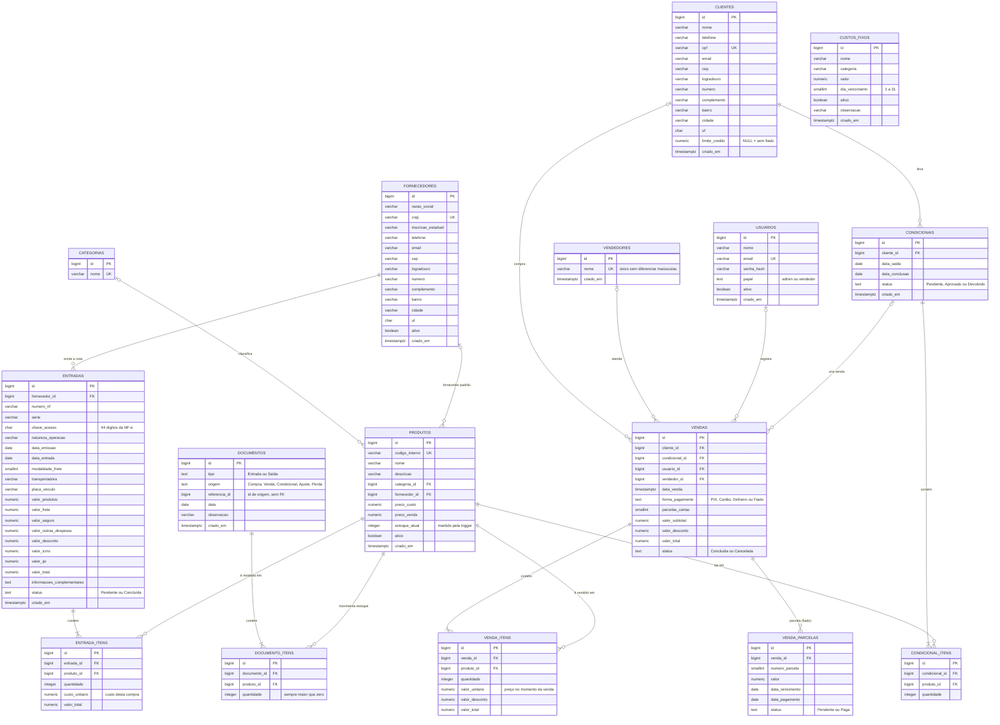

# Banco de dados do ModaSys

Banco relacional **PostgreSQL**, hospedado no **Supabase**. É um banco
único: só o backend (a API) se conecta a ele; o front-end nunca acessa
o banco direto, sempre passa pela API.

## Como usar

Tudo é rodado no Supabase, em **SQL Editor › New query › colar › Run**:

| Arquivo | Quando usar |
|---|---|
| `schema-supabase.sql` | Criar o banco do zero (tabelas, chaves, checagens, trigger e o papel `backend_role` que a API usa) |
| `migracao-001-vendedores.sql` | Só em um banco que já existia antes da tabela `vendedores` (pode rodar de novo sem problema) |
| `drop-schema-supabase.sql` | Apagar tudo para recomeçar (**apaga os dados**) |

`schema.sql` e `seed.sql` são a primeira versão do banco, em MySQL, de
quando o sistema rodava só no XAMPP com dados de exemplo. Ficam como
histórico do projeto e **não refletem o banco atual**.

## Diagrama Entidade-Relacionamento (DER)

Gerado a partir do banco em produção (outubro de 2026). Notação "pé de
galinha": `||` = exatamente um, `|o` = zero ou um, `|{` = um ou mais,
`o{` = zero ou mais. `PK` = chave primária, `FK` = chave estrangeira,
`UK` = valor único. O GitHub e o VS Code desenham este diagrama; para
imprimir, abra `docs/der.html` no navegador.

`CUSTOS_FIXOS` não se relaciona com as outras tabelas: é o cadastro das
despesas mensais da loja, usado no total do mês e no relatório.

## Por que essas tabelas

Cada tabela existe porque uma tela do sistema precisa dela:

| Tabela | Tela |
|---|---|
| `usuarios` | Login e Configurações (gestão de usuários, só admin) |
| `vendedores` | Campo "Vendedor" do PDV |
| `fornecedores` | Fornecedores |
| `clientes` | Clientes |
| `categorias` | Campo "Categoria" de Produtos e Entradas |
| `produtos` | Produtos |
| `entradas` + `entrada_itens` | Entradas (nota fiscal de compra ou entrada manual) |
| `condicionais` + `condicional_itens` | Condicionais |
| `vendas` + `venda_itens` | Vendas (PDV), recibo, painel e relatórios |
| `venda_parcelas` | Contas a Receber (vendas no fiado) |
| `custos_fixos` | Custos Fixos |
| `documentos` + `documento_itens` | Inventário, e por baixo dos panos de entradas, vendas e condicionais |

## Integridade dos dados

O banco não depende só da aplicação para manter os dados corretos:

- **17 chaves estrangeiras.** O que acontece ao apagar o registro
  referenciado foi escolhido caso a caso:
  - **CASCADE** nas tabelas de itens (`entrada_itens`, `venda_itens`,
    `condicional_itens`, `venda_parcelas`, `documento_itens`): o item não
    existe sem o seu cabeçalho.
  - **SET NULL** nas referências opcionais (categoria e fornecedor do
    produto; cliente, vendedor, usuário e condicional da venda): o
    histórico da venda fica, só perde a ligação.
  - **Bloqueio** (padrão) quando apagar quebraria o histórico: não dá
    para apagar um produto que já foi vendido, comprado ou movimentado.
    Por isso produtos, fornecedores, usuários e custos fixos são
    **desativados** (`ativo = false`) em vez de apagados.
- **Valores únicos:** CNPJ do fornecedor, CPF do cliente, código do
  produto, e-mail do usuário, nome da categoria e nome do vendedor (este
  sem diferenciar maiúsculas, por um índice em `lower(nome)`).
- **10 checagens (`CHECK`):** listas fechadas de status, papel, forma de
  pagamento, tipo e origem do documento; dia de vencimento entre 1 e 31;
  quantidade movimentada sempre maior que zero.
- **Transações na aplicação:** toda operação que grava em várias tabelas
  (uma venda grava a venda, os itens, as parcelas e o documento de
  estoque) roda numa transação: ou grava tudo, ou nada.

## Decisões de modelagem (para explicar na banca)

**Categoria e vendedor viraram tabelas, não texto solto.** Guardar
"Vestidos" como texto em cada produto deixa fácil digitar errado
("Vestido" vs "Vestidos") e difícil renomear depois. Uma tabela
`categorias` com `produtos.categoria_id` como chave estrangeira resolve
os dois problemas. O mesmo vale para `vendedores`: "Ana" e "ana " não
podem virar duas pessoas no relatório; por isso o nome é único sem
diferenciar maiúsculas. Na tela, o campo lista só as categorias (ou
vendedores) já usados, e um botão "+" cadastra um novo na hora.

**Vendedor é diferente do usuário logado.** `vendas.usuario_id` é o
login usado no sistema; `vendas.vendedor_id` é quem atendeu o cliente.
Várias vendedoras podem usar o mesmo login do caixa, então as duas
informações precisam ser separadas.

**Preço de venda é fotografado na venda.** `venda_itens.valor_unitario`
guarda o preço no momento daquela venda. Se o preço do produto mudar
amanhã, o histórico das vendas antigas não pode mudar junto, por isso é
uma cópia do valor daquele instante, e não uma referência a
`produtos.preco_venda`.

**Custo é de cada compra.** `entrada_itens.custo_unitario` guarda quanto
custou cada peça naquela entrada. Uma compra nova não muda o custo das
peças que já estavam no estoque, e a próxima entrada do mesmo produto
sugere o custo da última compra.

**Estoque é um saldo atualizado por uma trigger, não por código
espalhado.** `produtos.estoque_atual` guarda o saldo atual (recalcular
somando todo o histórico a cada tela ficaria lento com o tempo). Quem
mantém esse saldo é o banco: a tabela `documentos` (cabeçalho: Entrada
ou Saída, e a origem — Compra, Venda, Condicional, Ajuste de Inventário,
Perda/Avaria) e `documento_itens` (produto + quantidade). A trigger
`trg_documento_itens_atualiza_estoque` (`AFTER INSERT ON
documento_itens`) soma ou subtrai `produtos.estoque_atual`
automaticamente.

Por que um "livro-razão" (o kardex) em vez de cada tela mexer direto na
coluna: se surgir uma nova forma de tirar peça do estoque, ela só
precisa gravar um documento, sem replicar a regra de "subtrair estoque"
em mais um lugar do código. E para auditar todo movimento de uma peça,
basta consultar uma tabela, sem cruzar entradas, vendas e condicionais.

As tabelas de negócio (`entrada_itens`, `venda_itens`,
`condicional_itens`) continuam existindo: guardam preço, custo e
desconto de cada operação, que não cabem em `documentos`. As duas
coisas convivem: uma entrada grava em `entrada_itens` (quanto custou)
**e** em `documento_itens` (para mexer no estoque). Cancelar uma venda
ou devolver uma condicional gera um documento de Entrada, que devolve
as peças.

`referencia_id` em `documentos` aponta para a entrada, venda ou
condicional de origem, mas não é uma chave estrangeira: a tabela de
destino muda conforme a coluna `origem`, e SQL relacional não tem chave
estrangeira "polimórfica". Fica `NULL` em ajustes de inventário e
perdas, que não vêm de outra tabela.

**Desconto é salvo em reais; o percentual é só uma calculadora na
tela.** No PDV dá para digitar "% Desc." por item e um desconto geral,
mas o banco guarda o valor em reais resultante
(`venda_itens.valor_desconto` e `vendas.valor_desconto`). Para
relatório e conferência de caixa, o que importa é o valor final.

**`parcelas_cartao` é só informativo.** Guarda em quantas vezes o
cliente parcelou no cartão, mas não cria dívida: quem financia é a
operadora. É diferente de `venda_parcelas`, que é dívida real do
cliente com a loja (fiado).

**Fiado é parcela, não só uma forma de pagamento.** Uma venda no fiado
gera de 1 a N linhas em `venda_parcelas`, cada uma com vencimento e
status próprios. Os centavos que sobram da divisão vão para a última
parcela, para a soma bater exatamente com o total.

**Atraso é calculado, não gravado.** Uma parcela é `Pendente` até ser
paga; a tela decide se mostra "Atrasada" comparando o vencimento com a
data de hoje (no fuso de Brasília) na hora da consulta. Gravar isso
numa coluna exigiria um processo rodando todo dia só para atualizar o
status.

**`limite_credito` decide quem pode comprar no fiado.** Fica `NULL` por
padrão (sem fiado). Quando preenchido, é o teto de dívida em aberto do
cliente: ao fechar a venda, a aplicação soma as parcelas pendentes e
recusa a venda se o limite estourar.

**Toda venda nova tem cliente.** A aplicação exige o cliente em toda
venda. `vendas.cliente_id` ainda aceita `NULL` no banco porque as
primeiras vendas foram feitas como "Cliente Balcão" e o histórico delas
precisa continuar existindo. `condicional_id` só é preenchido quando a
venda nasce de uma condicional.

**Os campos de nota fiscal em `entradas` batem com a NF-e.** Número,
série, chave de acesso, transporte e totais (frete, seguro, ICMS,
IPI...) seguem as seções da nota. Uma futura importação do XML da NF-e
teria um campo pronto para cada informação.

**Endereço estruturado, não um texto único.** CEP, logradouro, número,
complemento, bairro, cidade e UF ficam em colunas separadas porque a
tela preenche boa parte sozinha: o CEP consulta a API ViaCEP, e no
fornecedor o CNPJ consulta a BrasilAPI. Colunas separadas também
permitem filtrar por cidade ou UF num relatório.
